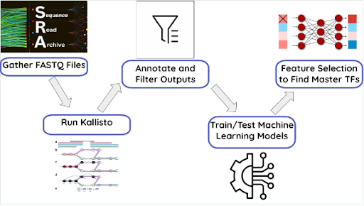
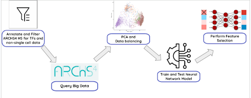
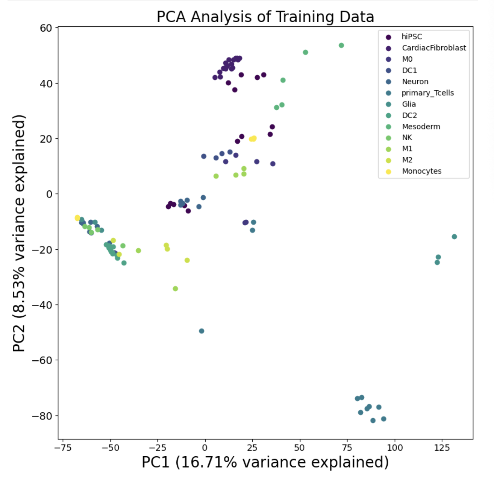
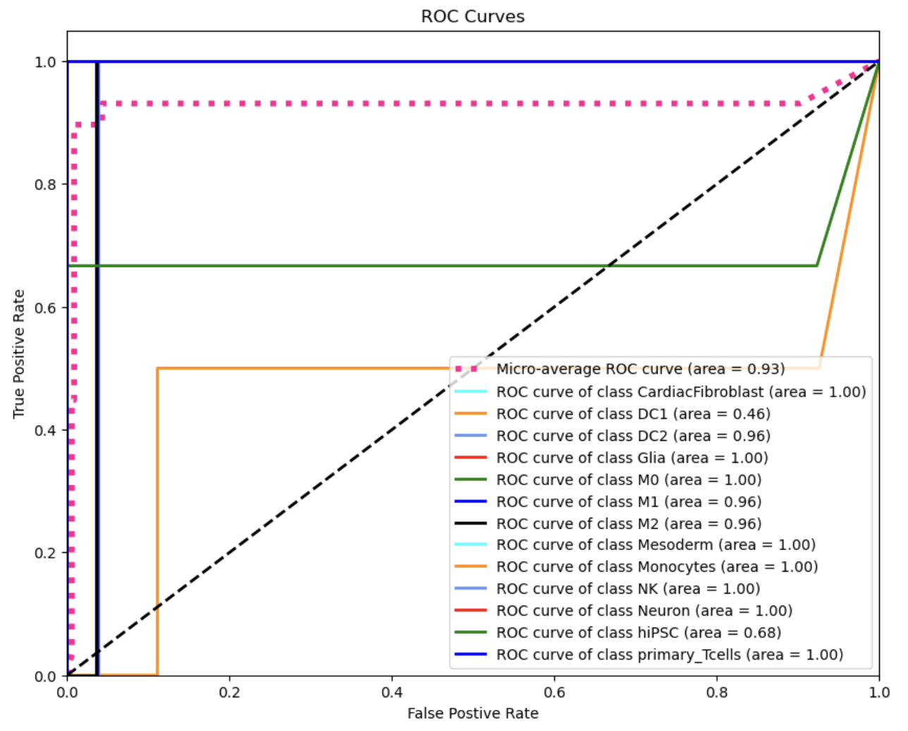
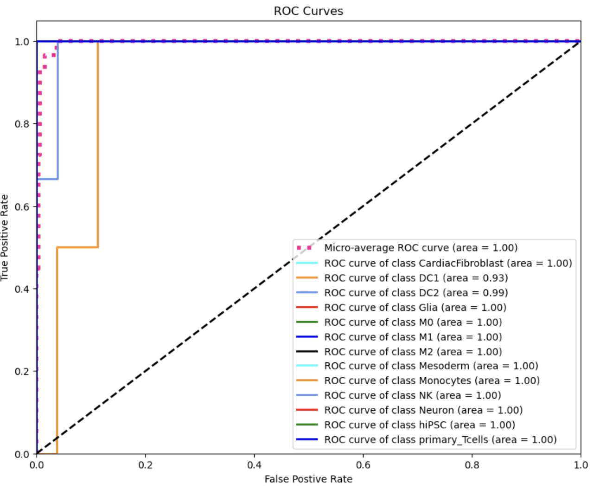
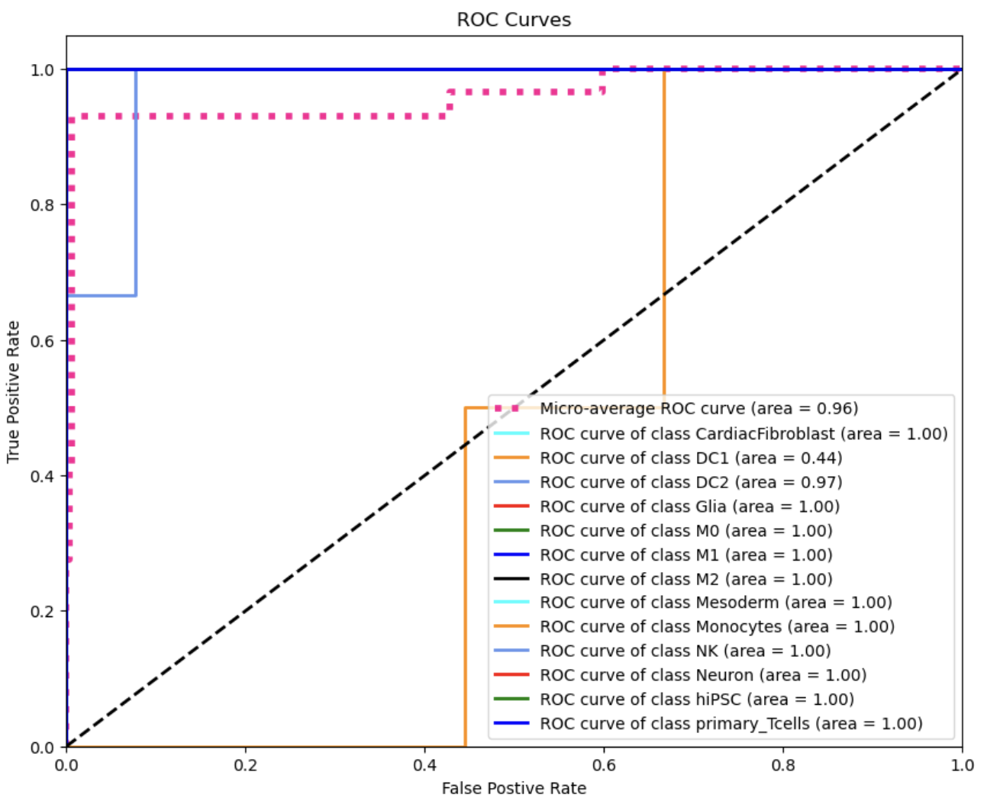
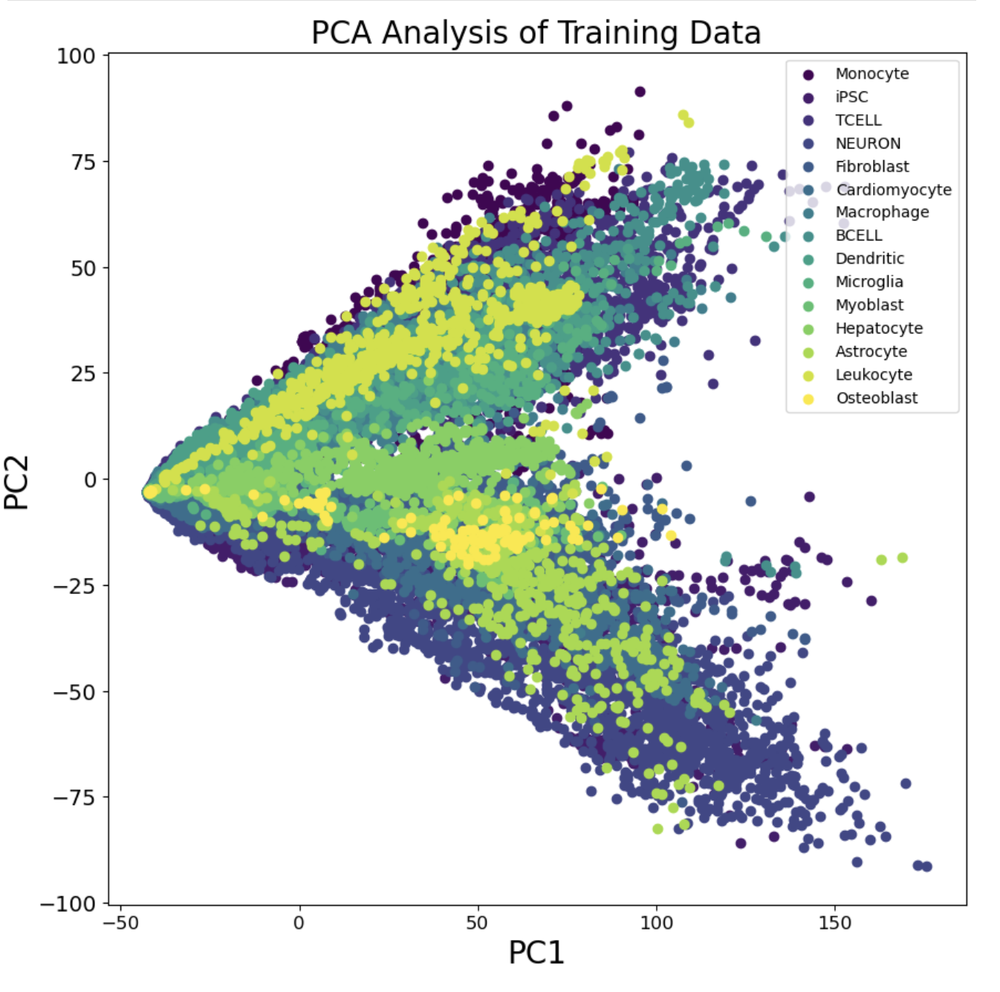
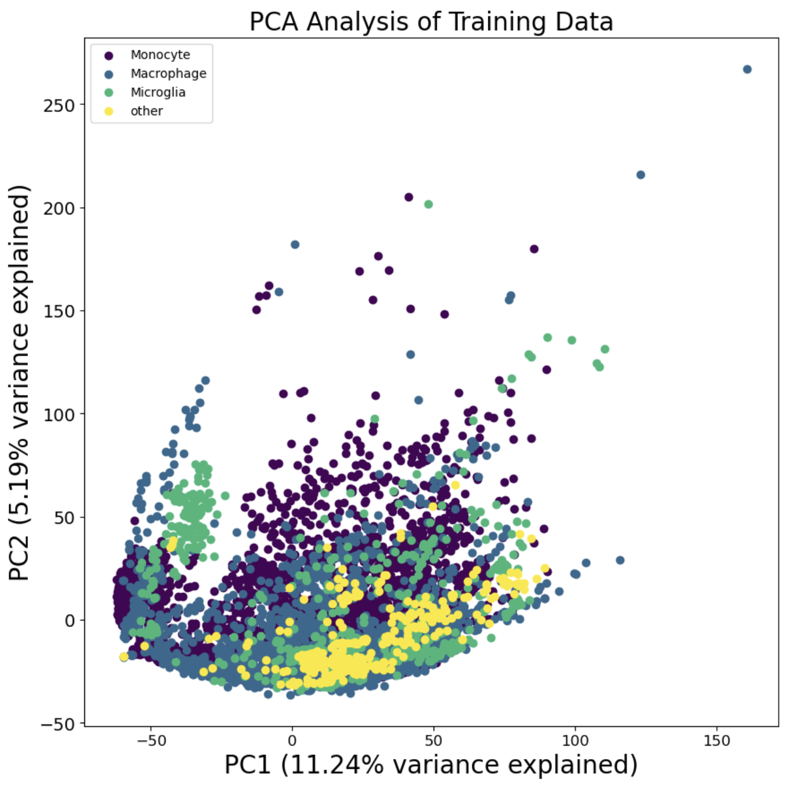
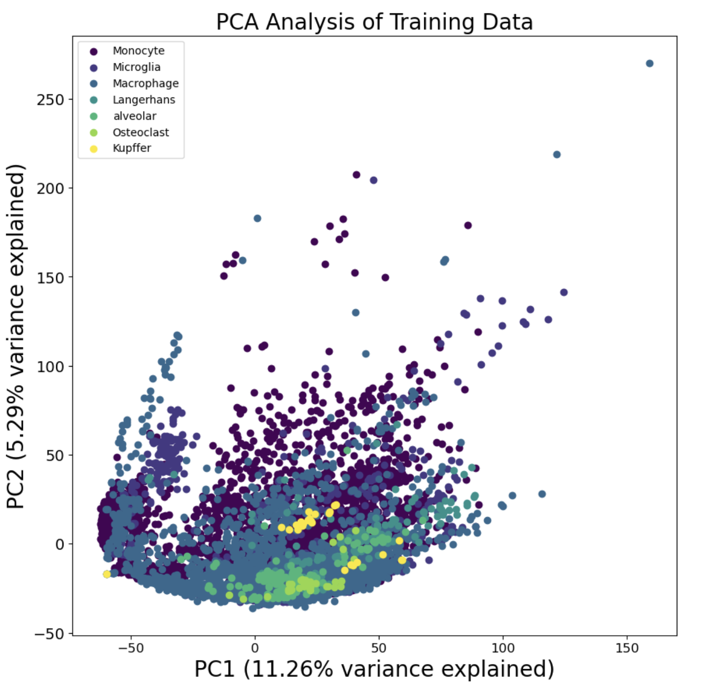

# ML-For-Macrophage-Master-TFs

Identifying novel master transcription factors and confirming studied cell
 type markers in macrophages using machine learning

---

## Project Overview

This project investigates whether machine learning models trained on transcription 
factor expression profiles can distinguish the gene regulatory networks of 
different cell types and find the master transcription factors for macrophages.

This project was done in collaboration with Dr. David Truong's lab at NYU 
Tandon School of Engineering, Department of Biomedical Engineering. 

There are three parts to this project: 
1. Training L1 Logistic Regression, Random Forest, and XGBoost models on the 
Truong Lab's database of bulk RNA-sequenced immune cells.
2. Training Neural Network model on bulk RNA-seq data of immune cells from 
ARCHS4. This includes transcription factor perturbation analysis to investigate 
key macrophage markers. 
3. Training Neural Network model on bulk RNA-seq data of macrophage subtypes 
from ARCHS4. This includes transcription factor perturbation analysis to 
investigate key macrophage markers. 

**Contents**

- Research Question and Motivation
- Methodology
- Data Curation
- Results
- Feature Selection and TF Perturbation Results
- Repository Structure
- Limitations and Next Steps
- References   

---

## Research Question and Motivation

I am investigating whether trained machine learning models can identify novel 
and known master transcription factors using feature selection functionalities. 
In the Truong Lab there is a need for identifying key transcription factors to 
be used in forward programming of iPSCs to macrophages. Macrophages have central 
functions in the human immune system that include metabolic functions, 
tissue repair, and clearing debris. This is an affected cell type in a variety of 
immune disorders and conditions, and is a major focus in immunology in general. 
Through the harmonization of the results from the three parts of this project, 
I was able to distinguish ZNF385A, CEBPA, CEBPB, and TSC22D1 as commonly 
recurring transcription factors that arose from feature selection or feature 
perturbations. With these results, the Truong lab will investigate the efficacy 
of these factors within the forward programming of their iPSC cultures.

---

## Methodology

## The three parts of this project had differing methodologies:

### Part 1: Training Logreg, Random Forest, XGBoost on internal RNA-Seq database:

*The contents of this part of the project are within the Non-NN-Pipeline folder of this repository*

<p align="center">
  
</p>

Part 1 started with the curation of data through the Sequence Read Archive or SRA. An extensive
 literature search was performed to find the SRA IDs of wildtype, non-diseased, 
and unedited cells that were sourced from primary cells or iPSCs. These samples belonged to the 
myeloid, lymphoid, and non-mesodermal lineages which also included macrophages. There were 122 
compiled SRA ID numbers that were subsequently Kallisto pseudoaligned to generate gene expression 
values. It is important to note that the macrophage category of samples was split into M0, M1, and 
M2 polarized samples, and that the this curated database was heavily imbalanced in regard to the 
number of samples for each included cell type. 

Prior to model training, the gene expression data was processed by normalizing the cell 
type class labels and by filtering for the expression values of known transcription factor genes. 
We wanted the trained models to learn how the expression of transcription factor genes related 
to the given cell type classifications. The data was then split into training and testing data 
via a 75:25 split, and the training data was log2 transformed and scaled using the StandardScaler 
object in python. The testing data was also log2 transformed and scaled using the StandardScaler 
object that was fit to the training data. Four different training datasets were generated using 
 methods of data oversampling to generate balanced datasets. I used Random Oversampler, 
SMOTE, and BorderlineSMOTE as the oversampling methods while the unbalanced dataset was the fourth 
training dataset. I created python functions to perform Bayesian Optimzation on the L1 Logreg, 
Random Forest, and XGBoost models for each of the four training datasets. Each instance of 
parameter optimization and model training was evaluated on the AUCs of the individual classes, 
micro-averaged AUC, micro-averaged F1 score, and accuracy. 

Once the models with the best evaluation metrics were found, I performed feature selection or 
feature importance evalutions to find the top 20 transcription factors that impacted the model 
classifications the most. From these top 20 lists, I performed literature searches to find out 
if the lists contained existing master transcription factors for macrophages, or undiscovered 
candidates. 

### Part 2: Training Neural Network model on bulk RNA-seq data from ARCHS4 (Immune Cells):

*The contents of this part of the project are within the NN-Pipeline folder of this repository*

<p align="center">
  
</p>

Part 2 utilized the All RNA-Seq and ChIP-seq Sample and Signature Search or ARCHS4 database which 
is a comprehensive repository of gene/transcript expression counts from the Gene Expression Omnibus 
and the SRA. This database contains counts from bulk RNA-seq, single-cell RNA-seq, and ChIP-seq 
experiments. All of the samples and expression values are contained within an HDF5 file that has  
a hierarchical metadata structure. The filtering of the HDF5 file was done through the 
utilization of the archs4py and h5py packages in python. The metadata filtering strategy was as follows:

---

Filter for transcriptomic data and filter out single-cell data from 'library_source' metadata.

  ↓ 

Extract all unique 'source_name_ch1' metadata and create individual source name text files that 
contain source names for each cell type of interest. Filter out samples from diseased, edited, or 
immortalized cell lines that did not come from primary cells or iPSCs. 

  ↓ 

Filter for known transcription factor genes. 

---

*It is important to note that due to available RAM constraints in NYU's HPC environment, I had to 
employ a chunking approach to filtering the ARCHS4 HDF5 file where these filters were performed 
in chunks of 1000 samples or 1000 genes.*

The final filtered ARCHS4 HDF5 file contained 63,324 samples of varying cell types with expression 
values for 13,146 transcription factors. The chunking approach was used again to split this data 
into training and testing datasets with a 75:25 split. 

The training data was highly unbalanced with varying number of samples for each cell type, so the 
oversampling methods of Random Oversampler, SMOTE, and BorderlineSMOTE were used. Prior to 
oversampling, the training and testing data were log2 transformed and not scaled. I decided that 
scaling was unnecessary since it had no major effect on the improvement of the model's evaluation 
metrics during training. 

I made a function that trained a keras neural network model with two dense layers containing 250 
nodes. The model included the Adam optimizer with early stopping based on the validation data loss. 
The model was trained with four training datasets: Random Oversampler, SMOTE, BorderlineSMOTE, and 
unbalanced. The best epoch of training for each dataset was saved for use in the Node Light Up 
perturbation testing. The Node Light Up perturbation testing was performed on each of the four 
trained models and the top 20 transcription factors with the highest perturbation scores were 
displayed. 

*For detailed information on the neural network architecture and the Node Light Up perturbation 
technique, see Magnusson et al., "Deep Neural Network Prediction of Genome-Wide Transcriptome 
Signatures - beyond the Black-Box" in the References section.* 

### Part 3: Training Neural Network model on bulk RNA-seq data from ARCHS4 (Macrophage Subtypes):

*The contents of this part of the project are within the Macrophage_only_NN-pipeline folder of 
this repository*

Part 3 was almost identical to part 2 except I filtered and queried only for subtypes of macrophage 
cells instead of other immune cells. The subtypes were macrophages, monocytes, microglia, alveolar 
macrophages, langerhans cells, osteoclasts, and kupffer cells. I decided to repeat part 2 with 
only subtypes of macrophages to assess if the neural network and subsequent perturbation study could 
identify subtype specific markers as well as general macrophage markers. I trained two iterations 
of Neural Networks with this data where one iteration trained these 7 subtypes as 7 distinct classes,
 and another iteration trained 4 distinct classes with all subtypes combined except for macrophages 
monocytes, and microglia. The 4 class neural network was necessary to find distinctive transcription 
factors for monocytes, macrophages, and microglia since the Truonglab was most interested in these 
subtypes. 

This part also included a function containing the neural network architecture with pytorch as well as a 
function with keras. Both functions were used to train the model for the purpose of assessing
 the difference in evaluation metrics, and practicing usage of the pytorch package. The evaluation 
metrics for models written with keras and pytorch were highly similar, so I only used the keras 
models for subsequent Node Light Up testing to keep the process consistent with Part 2. 

---

## Results

### Part 1: Best Metrics for Logreg, Random Forest, and XGBoost:

Below shows the principal component analysis of the samples used in part 1:

<p align="center">
  
</p>

L1 Logistic Regression had the highest microaveraged F1 score of 0.84 when trained on 
the Random Oversampler balanced training data. The ROC-AUC plot with corresponding AUC metrics is 
shown below: 

<p align="center">
  
</p>  

Random Forest had the highest microaveraged F1 score of 0.93 when trained on
the Random Oversampler balanced training data. The ROC-AUC plot with corresponding AUC metrics is
shown below:

<p align="center">
  
</p>

XGBoost had the highest microaveraged F1 score of 0.93 when trained on the unbalanced training data. 
The ROC-AUC plot with corresponding AUC metrics is shown below:

<p align="center">
  
</p>

---

### Part 2: Best Metrics for Neural Network Trained on ARCHS4 Immune cell types:

Below shows the principal component analysis of the samples used in part 2:

<p align="center">
  
</p>

The Neural Network had the highest microaveraged F1 score of 0.97 when trained on the Random 
Oversampler balanced training data. All of the other balancing methods also resulted in high F1 
and AUC scores, but Random Oversampler beat them out by a 0.001 magnitude of F1 score. All of the 
individual class type AUC scores and the microaveraged AUC score for the Random Oversampler trained 
model was 0.99 or higher. The Random Oversampler trained model was used for subseqeunt Node Light 
Up testing. 

---

### Part 3: Best Metrics for Neural Network Trained on ARCHS4 Macrophage Subtypes:

Below shows the principal component analysis of the samples used in part 3 (4 class NN):

<p align="center">
  
</p>

The 4 class Neural Network had the highest microaveraged F1 score of 0.98 when trained on the 
BorderlineSMOTE balanced training data. All of the other balancing methods also resulted in high F1 
and AUC scores, but BorderlineSMOTE beat them out by a 0.002 magnitude of F1 score. All of the 
individual 4 class AUC scores and the microaveraged AUC score was 0.99 or higher. The 
BorderlineSMOTE trained model was used for subsequent Node Light Up testing. 

Below shows the principal component analysis of the samples used in part 3 (7 class NN):

<p align="center">
  
</p>

The 7 class Neural Network had the highest microaveraged F1 score of 0.98 when trained on the
Random Oversampler balanced training data. All of the
individual 7 class AUC scores and the microaveraged AUC score was 0.99 or higher. The           
Random Oversampler trained model was used for subsequent Node Light Up testing.

---

## Feature Selection and TF Perturbation Results

---

## Repository Structure

```text
ML-For-Macrophage-Master-TFs/
|
├── Macrophage_only_NN_pipeline/
|      ├── ARCHS4_filtering/
|      |      ├── ARCHS4_Filter_1_2_3.py
|      |      ├── ARCHS4_Source_name_filtering.ipynb
|      |      └── Run_ARCHS4_Source_name_filtering.ipynb
|      ├── ARCHS4_NN_4_Class.ipynb
|      └── ARCHS4_NN_7_Class.ipynb
|
├── NN-Pipeline/
|      ├── ARCHS4_filtering/
|      |      ├── ARCHS4_Filtering.py
|      |      ├── ARCHS4_TF_Filter.py
|      |      ├── ARCHS4_filtering.ipynb
|      |      ├── ARCS4_SC_filter.py
|      |      ├── Run_ARCHS4_SC_Filtering_1.sbatch
|      |      ├── Run_ARCHS4_filtering_2.sbatch
|      |      └── Run_TFs_ARCHS4_filter_3.sbatch
|      ├── ARCHS4_NN.ipynb
|      └── Node_Light_Up.ipynb
|
├── Non-NN-Pipeline/
|      └── ML_Non-NN_Final.ipynb
|
└── README.md 

```

---

## Limitations and Next Steps

---

## References

1. Lachmann, Alexander. “ARCHS4.” Maayanlab.cloud, 2018, maayanlab.cloud/archs4/.
2. “2. Over-Sampling — Version 0.9.1.” Imbalanced-Learn.org, imbalanced-learn.org/stable/over_sampling.html.
3. Chawla, N. V., et al. “SMOTE: Synthetic Minority Over-Sampling Technique.” Journal of Artificial Intelligence Research, vol. 16, no. 16, 1 June 2002, pp. 321–357, https://doi.org/10.1613/jair.953.
4. Han, Hui, et al. “Borderline-SMOTE: A New Over-Sampling Method in Imbalanced Data Sets Learning.” Lecture Notes in Computer Science, vol. 3644, 2005, pp. 878–887, dl.acm.org/citation.cfm?id=2141297, https://doi.org/10.1007/11538059_91.
5. Magnusson, Rasmus, et al. “Deep Neural Network Prediction of Genome-Wide Transcriptome Signatures – beyond the Black-Box.” Npj Systems Biology and Applications, vol. 8, no. 1, 23 Feb. 2022, pmc.ncbi.nlm.nih.gov/articles/PMC8866467/, https://doi.org/10.1038/s41540-022-00218-9. Accessed 31 Jan. 2025.
